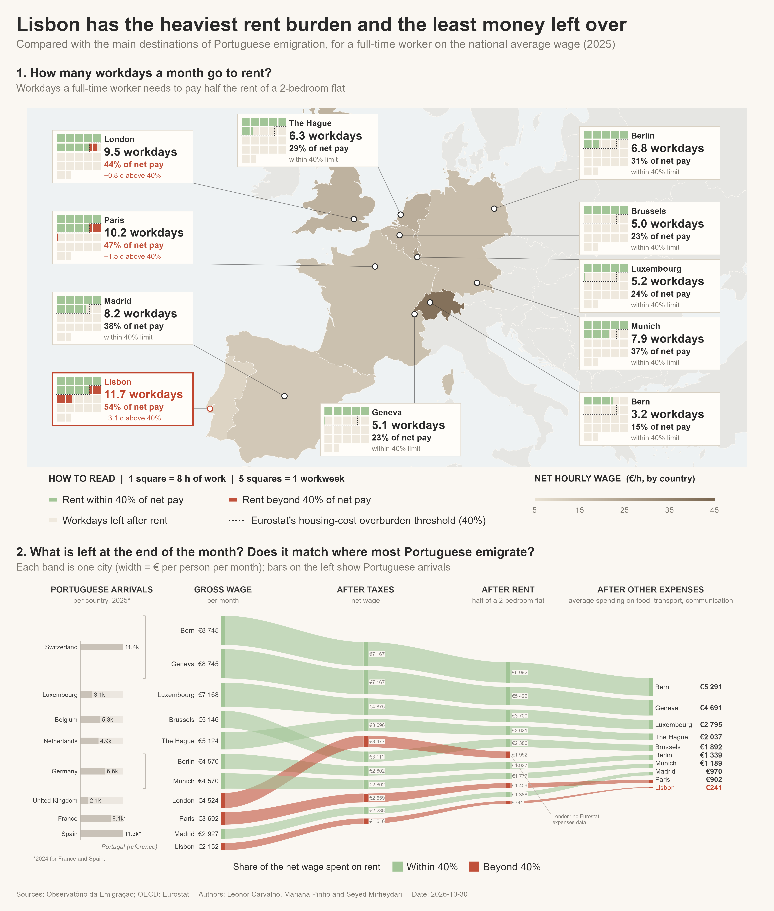

# Leaving Portugal Pays Off, but Not Equally Everywhere

**A data visualization project comparing housing affordability and disposable income across Lisbon and major European destinations for Portuguese emigrants.**

The project explores a practical question: **does earning more abroad translate into a better financial position after taxes, rent, and everyday expenses?** It compares 11 cities across nine European countries, using Lisbon as the reference.



## What the visualization shows

The final figure combines two complementary views:

- **European map with waffle charts:** each square represents an eight-hour workday. The cards show how many workdays are needed to cover half the monthly rent of a two-bedroom flat, alongside the share of net income spent on rent. A 40% reference threshold helps identify higher housing burdens.
- **Income-flow Sankey diagram:** follows the estimated monthly income from gross wage to net wage, then after rent and selected everyday expenses. A small bar chart adds context on Portuguese emigration arrivals by destination country.

This approach connects **working time, housing affordability, and the money left at the end of the month** rather than comparing salaries alone.

## Data sources

Six datasets were combined:

| Source | Information used |
|---|---|
| **OECD** | Average annual gross wages; income tax and employee social security contributions for a single worker earning the average wage |
| **Eurostat** | Exchange rates, city-level rents for two-bedroom flats, and nominal expenditure per inhabitant for food and non-alcoholic beverages, transport, and communication |
| **Observatório da Emigração** | Annual arrivals of Portuguese nationals by destination country |

The main reference years are **2025** for wages, exchange rates, rents, and most arrivals, and **2024** for everyday expenditure and arrivals in France and Spain.

## Data preparation and assumptions

Preprocessing in R includes cleaning the original spreadsheets, harmonizing country and city names, converting national currencies to euros, merging country- and city-level indicators, and deriving monthly and hourly earnings.

To make the comparisons consistent, we assumed:

- **40 working hours per week, 52 weeks per year** (2,080 hours), or eight hours per workday.
- **Two people sharing a two-bedroom flat**, each paying half the monthly rent.
- A **40% rent-to-net-wage benchmark**, adapted from Eurostat's housing-cost overburden threshold; this is *not* the same as Eurostat's complete household indicator.
- Monthly everyday expenditure estimated from selected annual expenditure categories, divided by 12.

Missing values were not imputed. The United Kingdom has no values in the selected expenditure series, so **London is shown in the housing comparison but not in the final after-expenses comparison**.

## Repository structure

```text
.
├── README.md
├── .gitignore
├── data_preparation.R
├── map_plot.R
├── sankey_plot.R
├── final_visualization.R
├── project_data.xlsx
├── intermediateDatasets/        # Original spreadsheet exports, if redistribution is permitted
├── figures/
│   ├── final_visualization.png
│   ├── intermediate_1.png
│   └── intermediate_2.png
└── report/
    └── Report.pdf
```

The `intermediateDatasets/` folder is optional if the original source files cannot be redistributed. In that case, retain `project_data.xlsx` and document how the source data can be obtained.

## Running the project

1. Open the repository folder in RStudio. In the R scripts, **remove or update the Windows-specific `setwd(...)` lines** so that the working directory is the root of this repository.
2. Install the required R packages:

   ```r
   install.packages(c(
     "readxl", "dplyr", "tidyr", "writexl", "ggplot2",
     "sf", "rnaturalearth", "rnaturalearthdata", "patchwork", "ragg"
   ))
   ```

3. If the six original datasets are available in `intermediateDatasets/`, run:

   ```r
   source("data_preparation.R")
   ```

   This creates `project_data.xlsx`.

4. Generate the visualization:

   ```r
   source("final_visualization.R")
   ```

   The script loads the map and Sankey scripts and exports the final figure.

**Note:** Keep the filename `project_data.xlsx` unless you update the paths in the R scripts. For the README image preview to display, place the chosen final PNG at `figures/final_visualization.png`.

## Limitations

The comparison uses **national average wages and expenditure** with **city-level rents**. National averages may overstate the financial conditions experienced by typical workers or people earning below average. The analysis also assumes shared accommodation, covers only selected everyday expenses, and uses data from different reference years. The resulting amounts are standardized comparisons, **not forecasts of individual savings or overall quality of life**.

## Team

**Team T03** — Leonor Carvalho, Mariana Pinho, and Seyed Mirheydari.

- **Leonor Carvalho:** data preparation and preprocessing, Sankey diagram, and additional data collection.
- **Mariana Pinho:** map and waffle charts, visual refinement.
- **Seyed Mirheydari:** visual editing and report presentation.

The concept and dataset research were collaborative; Leonor and Mariana also worked on the written report.

## Generative AI disclosure

ChatGPT was used to support R coding and debugging, exploration of design alternatives, and editing of report text. The team reviewed suggestions and remained responsible for the data, assumptions, visual design choices, and conclusions.

---

*Academic project for the Data Visualization and Preparation course, Master's in Data Science, University of Porto (FEUP), 2026/27.*
